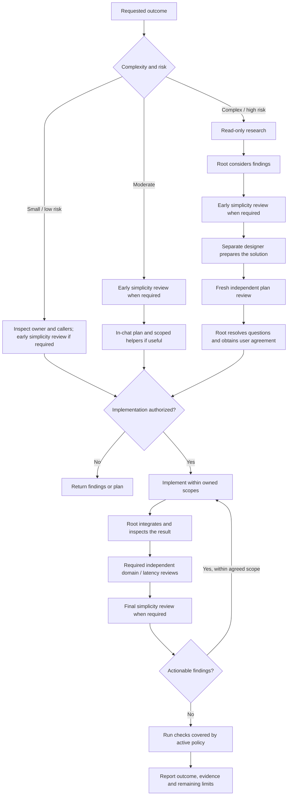
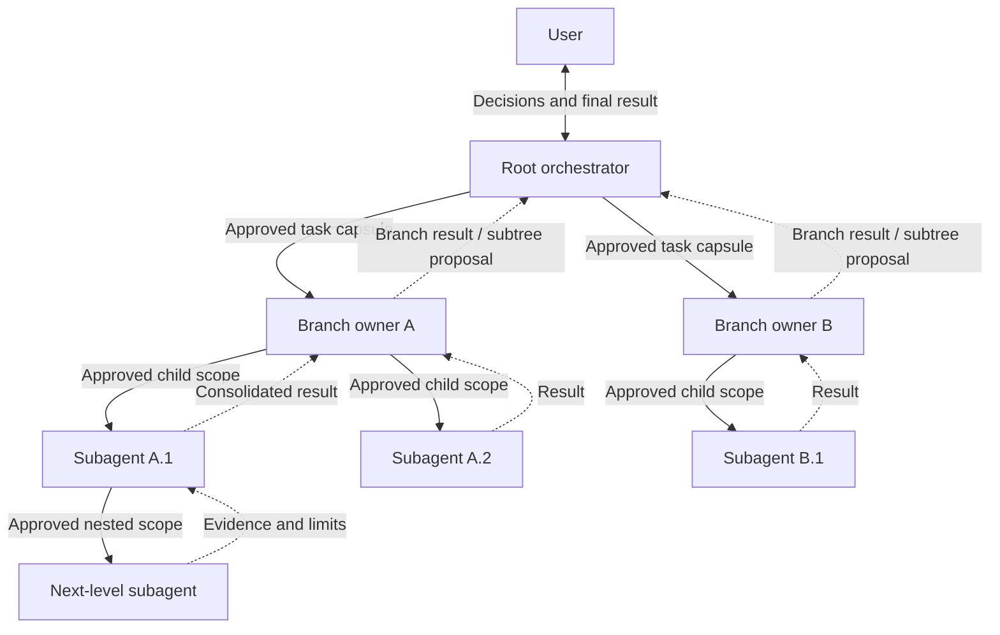

# Blazing Market

**Engineering practices for crypto and other financial-market software.**

An open-source [Agent Skill](https://agentskills.io/) for analyzing, reviewing,
designing and developing market-data pipelines, trading systems and financial
calculations. It brings hot/cold-path discipline, bounded resources, explicit
ownership and independent review to your coding agent, in any language.

[Quick start](#quick-start) · [Engineering practices](#engineering-practices) ·
[Workflow](#workflow-by-complexity-and-risk) · [Recursive delegation](#recursive-delegation) ·
[Evidence](#evidence-and-permissions)

## Quick start

From your project directory:

```bash
npx skills add be0hhh/blazing-market
```

Choose the coding agents to install to. For installation across projects:

```bash
npx skills add be0hhh/blazing-market -g
```

Requires Node.js and npm; see the [skills CLI](https://github.com/vercel-labs/skills)
for current prerequisites and supported agents. One installation includes the
skill and all its references. Compatible clients include Codex and Claude Code;
available agent and orchestration capabilities depend on the client.

Then ask your agent to use it:

> Use blazing-market to review this market-data feed. Trace the selected parser
> and its consumers; check sequencing, snapshots/deltas, timestamps and bounded
> backpressure. Report findings without edits.

Other starting points:

- **Latency analysis:** "Use blazing-market to trace this event-to-order path.
  Separate hot work from control and diagnostics, identify supported bottleneck
  candidates, and propose measurements before claiming an improvement."
- **Session recovery:** "Use blazing-market to review order-session recovery.
  Check generation changes, pending correlation, partial writes, unknown
  outcomes and resend policy. Raise unresolved behavior before changes."

## Engineering practices

The skill follows the actual runtime, protocol, workload and project policy.
It applies to crypto and other markets without assuming one exchange, language,
build system or trading model.

| Practice | What the agent examines |
| --- | --- |
| **Trace the real path** | Active registration, selected wire, compiled or loaded implementation, publication, consumers and terminal send |
| **Separate hot and cold work** | Critical computation, adjacent state, lifecycle/control and deep diagnostics |
| **Bound resources** | Memory, queues, parser work, ownership, lifetimes, backpressure and overflow/refusal behavior |
| **Preserve market semantics** | Identity, sequence, epochs, snapshots/deltas, clock domains, freshness and numeric scales |
| **Respect execution state** | Admission, reservations, intent/correlation before submission, ACK/fill/cancel races and unknown outcomes |
| **Keep one authority** | Canonical state owners, cohesive responsibilities and complete producer/consumer changes |
| **Prove the result** | Separate source findings, tests, runtime observations, performance measurements and live evidence |

### Hot-path profiles

Classify work by what it actually does:

| Class | Purpose |
| --- | --- |
| **H0** | Critical steady-state event-to-consumer or event-to-action path |
| **H1** | Adjacent state and handoffs that H0 correctness depends on |
| **C** | Cold/control work: configuration, connection setup, authentication and recovery |
| **D** | Deep diagnostics: traces, reports, dashboards and viewers |

Bounded ownership and correct behavior apply throughout. The optional
[ultra-low-latency profile](skills/blazing-market/references/ultra-low-latency-profile.md)
adds strict no-allocation, no-floating-point and other H0 restrictions when
selected by the user or project. An existing strict project policy stays active;
the skill does not silently impose that profile on every language or workload.

## Workflow by complexity and risk

Match the process to the consequences of the change, not the size of the diff.
A small edit to recovery or live-order behavior can still be high-risk.

The diagram shows implementation work. A review request stops at findings;
a planning request stops at the proposal. Neither authorizes implementation.



- **Small tasks stay small.** No full cascade, durable plan or arbitrary agent quota.
- **Substantive code work receives early and final simplicity review** when
  independent agents are available. Final simplicity review follows the relevant
  specialist reviews; tiny mechanical edits do not require these consultations.
- **Actual H0/H1 changes receive two independent reviews:** latency/bounded
  computation and the relevant domain specialist. The same pair applies to
  substantive offline financial computation under an explicit H0 contract.
- **Material questions return to the user through root.** Changed behavior or
  failure policy is settled before dependent work. An unchanged agreed plan and
  active execution permission need no renewed approval.
- **Unavailable independent stages are reported.** Self-review never substitutes
  for an independent designer or reviewer. Independent authorized work continues;
  unresolved material decisions stop dependent implementation.

## Recursive delegation

The root orchestrator owns the whole result. A branch owner may propose its own
subagents, which may propose another level when useful. Every proposed subtree
requires root approval before creation, within the user's existing permissions.



Solid arrows carry approved assignments downward; dashed arrows return evidence,
questions and proposals upward. A nested proposal travels through its parents to
root; approval returns through the same chain before that subtree is launched.

Each parent integrates its accepted branch. Root reconciles branches, owns shared
integration files and routes user decisions back down. Workers receive concrete
outcomes, non-overlapping ownership, relevant contracts and exact authorized
actions. Reviewers remain independent of the authors they review. No depth or
worker count is a goal: recursion serves useful independent work.

The complete contracts are in
[delegation and review](skills/blazing-market/references/delegation-and-review.md)
and [workflow and plans](skills/blazing-market/references/workflow-and-plans.md).

## Evidence and permissions

A source-level optimization is a **candidate** until comparable measurements
demonstrate an improvement. A working parser does not by itself prove complete
exchange support; a successful build does not prove live trading readiness.

Report source inspection as **static-only**. Identify build, targeted-test,
runtime, browser, model, performance and live evidence separately, with the
actual exercised scope and results. Missing evidence remains visible.

The user's instructions, project rules and runtime restrictions govern edits
and checks. The skill adds no approval ritual for ordinary tests already covered
by that policy. A plan, hook or worker cannot grant additional authority;
external and account/order actions retain their applicable permission boundaries.

This repository supplies instructions and references. It does not install a
background service, run an executable scanner, connect to an exchange, or
provide a trading strategy. No latency gain is claimed without measurements.

## Skill layout

```text
skills/blazing-market/
  SKILL.md          # Entry point and context routing
  references/       # Engineering and workflow contracts, loaded as needed
```

The [skill entry point](skills/blazing-market/SKILL.md) routes to the relevant
references for architecture, hot paths, parsers, transport, execution, recovery,
measurement, agent workflows and reporting. Agents read only what the task needs.

## License

[Apache-2.0](LICENSE).
