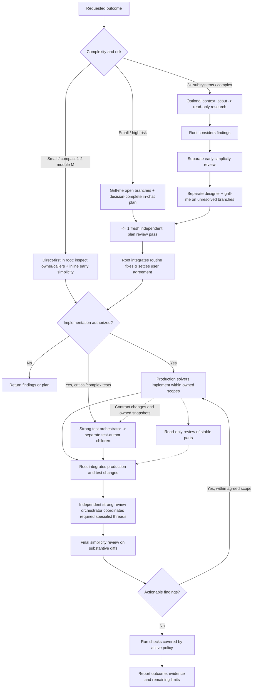
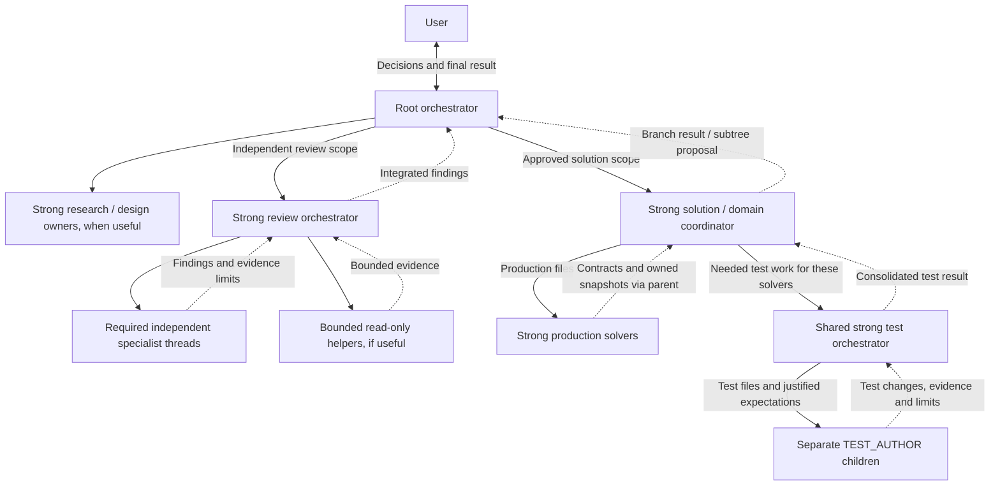

# Blazing Market

**Engineering practices for market-data, trading and low-latency financial systems.**

An open-source [Agent Skill](https://agentskills.io/) for analyzing, reviewing,
designing and developing market-data pipelines, trading systems and financial
calculations. It brings hot/cold-path discipline, bounded resources, explicit
ownership and independent review to your coding agent, in any language.
Project rules take precedence; hot-path obligations are distinguished from
cold/control work, with strict constraints for explicitly low-latency systems.

[Quick start](#quick-start) · [Engineering practices](#engineering-practices) ·
[Workflow](#workflow-by-complexity-and-risk) · [Recursive delegation](#recursive-delegation) ·
[Evidence](#evidence-and-permissions)

## Quick start

From your project directory:

```bash
npx skills add be0hhh/blazing-market
```

Choose the coding agents to install to. For installation across projects:

```bash
npx skills add be0hhh/blazing-market -g
```

Requires Node.js and npm; see the [skills CLI](https://github.com/vercel-labs/skills)
for current prerequisites and supported agents. One installation includes the
skill and all its references. Compatible clients include Codex, Antigravity,
and Claude Code; available agent and orchestration capabilities depend on the
client. For large codebases, pairing the skill with a shared local RAM/symbol
context server such as [ctx-mcp](https://github.com/be0hhh/ctx-mcp) is optional
and helps avoid repeated file slicing and redundant reads.

Then ask your agent to use it:

> Use blazing-market to review this market-data feed. Trace the selected parser
> and its consumers; check sequencing, snapshots/deltas, timestamps and bounded
> backpressure. Report findings without edits.

Other starting points:

- **Latency analysis:** "Use blazing-market to trace this event-to-order path.
  Separate hot work from control and diagnostics, identify supported bottleneck
  candidates, and propose measurements before claiming an improvement."
- **Session recovery:** "Use blazing-market to review order-session recovery.
  Check generation changes, pending correlation, partial writes, unknown
  outcomes and resend policy. Raise unresolved behavior before changes."

## Engineering practices

The skill follows the actual runtime, protocol, workload and project policy.
It applies to crypto and other markets without assuming one exchange, language,
build system or trading model.

| Practice | What the agent examines |
| --- | --- |
| **Trace the real path** | Active registration, selected wire, compiled or loaded implementation, publication, consumers and terminal send |
| **Separate hot and cold work** | Critical computation, adjacent state, lifecycle/control, integer-division elimination and deep diagnostics |
| **Trace network costs separately** | RX/TX protocol, socket, kernel and NIC costs alongside transport correctness and endpoint/location evidence |
| **Bound resources** | Memory, queues, parser work, ownership, lifetimes, backpressure and overflow/refusal behavior |
| **Preserve market semantics** | Identity, sequence, epochs, snapshots/deltas, clock domains, freshness and numeric scales |
| **Respect execution state** | Admission, reservations, intent/correlation before submission, ACK/fill/cancel races and unknown outcomes |
| **Keep one authority** | Canonical state owners, cohesive responsibilities and complete producer/consumer changes |
| **Prove the result** | Separate source findings, tests, runtime observations, performance measurements and live evidence |

### Hot-path profiles

Classify work by what it actually does:

| Class | Purpose |
| --- | --- |
| **H0** | Critical steady-state event-to-consumer or event-to-action path |
| **H1** | Adjacent state and handoffs that H0 correctness depends on |
| **C** | Cold/control work: configuration, connection setup, authentication and recovery |
| **D** | Deep diagnostics: traces, reports, dashboards and viewers |

Bounded ownership and correct behavior apply throughout. The
[ultra-low-latency profile](skills/blazing-market/references/ultra-low-latency-profile.md)
adds strict no-allocation, no-floating-point and other restrictions to hot
operations when user/project explicitly identifies the market/trading system
as LOW LATENCY, or explicitly selects the profile. An HFT label is unnecessary;
H0, market data or “fast” alone is insufficient. Project policy controls scope;
offline computation needs an explicit additional strict requirement.

## Workflow by complexity and risk

Match the process to the consequences of the change, not the size of the diff.
A small edit to recovery or live-order behavior can still be high-risk.

The diagram shows implementation work. A review request stops at findings;
a planning request stops at the proposal. Neither authorizes implementation.



- **Direct-first Risk S and compact 1–2 module Risk M.** Handle discovery,
  planning, and inline early simplicity directly in the primary agent without a
  full cascade or durable plan. Reserve a separate early simplicity subagent and
  full research/design cascade for **3+ subsystem** or **Risk H** work.
- **Grill-me on non-trivial plans, `<= 1` fresh plan review pass, and Boost on
  contested decisions.** Interview the user down unresolved design branches with
  code-grounded recommendations before locking a Risk M/H plan; cap fresh
  independent plan review at at most one pass (integrating routine findings
  directly without `v2`/`v3` loops); focus evidence-backed **boost** resolution
  strictly on contested decisions.
- **Optional `context_scout` + full actionable task specs.** Use a fast
  read-only 2–4 turn scout on unfamiliar multi-file surfaces to return a compact
  Scope Map (paths, lines, symbols, callers) without conclusions, and give
  strong workers self-contained specs plus portable whole-file/symbol retrieval
  and anti-stall delivery rules.
- **Proportionate test ownership.** Localized mechanical test/fixture repairs
  (preserving scenarios and assertions) and ordinary regressions with
  unambiguous expected outcomes may stay with the fix author or root. Critical
  scenarios (financial, recovery, order-state, authority, or expectations
  needing independent justification) require an independent strong test
  orchestrator and separate test-author children.
- **Critical changes follow the canonical
  [review matrix](skills/blazing-market/references/delegation-and-review.md#critical-review-matrix).**
  Actual network H0/H1 changes require three independent computation/memory,
  network latency and transport reviews. Pure C/D networking selects expertise
  by concrete risk after bounded inspection establishes no hot-path effect;
  selected strict offline finance retains its latency and quant pair.
- **Integer-division audit on hot/strict compute paths.** Inspect every
  unproved runtime `/` and `%` on touched hot or strict financial cores,
  preferring compile-time evaluation, cross-multiplication, or cold-prepared
  invariant divisors (`FastDivisor`) outside fixed power-of-2/10 scales.
- **Material questions return to the user through root.** Changed behavior or
  failure policy is settled before dependent work. An unchanged agreed plan and
  active execution permission need no renewed approval.
- **Unavailable independent stages are reported.** Self-review never substitutes
  for an independent designer or reviewer. Independent authorized work continues;
  unresolved material decisions stop dependent implementation.

## Recursive delegation

The root orchestrator owns the whole result. A branch owner may propose its own
subagents, which may propose another level when useful. Every proposed subtree
requires root approval before creation, within the user's existing permissions.



Solid arrows carry approved assignments downward; dashed arrows return evidence,
questions and proposals upward. A nested proposal travels through its parents to
root; approval returns through the same chain before that subtree is launched.

Each parent integrates its accepted branch. Root reconciles branches, owns shared
integration files and routes user decisions back down. Workers receive concrete
outcomes, non-overlapping ownership, relevant contracts and exact authorized
actions. Reviewers remain independent of the authors they review. No depth or
worker count is a goal: recursion serves useful independent work.

Strong branch owners handle coherent research, design, solution, test or review
responsibilities when useful; the tree does not require all phases or empty
levels. The solution owner closes behavior, interfaces, dependencies and its
integration scope. Substantive production authors are strong agents. Mechanical
helpers in solution/review branches collect bounded read-only evidence from
complete specifications; host policy may also allow mechanical document edits.
The independent strong review orchestrator assigns risk coverage and integrates
findings while required specialists remain distinct independent threads. It
cannot replace their clearance, override concrete vetoes or write the reviewed
implementation. Repairs return to authors with bounded re-review.

These roles use the host's same native agent swarm and its actual exposed
worker/helper, coordinator, board/event and communication capabilities. Do not
add a second scheduler, dispatcher, queue, daemon, private API or vendor patch.
If child helpers are unavailable, root dispatches the approved leaves
and returns results to their branch owner, reporting the flattened runtime
honestly. Complete task capsules carry decisions and bounded context; a shared
board does not make reviewers independent. Fresh reviewers exclude peer opinions
and prior verdicts. Host model routing, permissions and risk gates still apply.

An individual solver's test scope uses solver → test orchestrator → test authors.
One shared test orchestrator can serve multiple related solvers as a child of
their nearest common coordinator, as shown above; common tests have one owner
there. Do not add an empty solver level. Tiny test work needs only
root → test orchestrator → test author. The orchestrator owns risk analysis,
sufficient cases, independent expected results, fixtures and triage; authors
own test edits. Critical or unclear tests use a strong author; mechanical authors
receive complete ready specifications. Model selection follows the host's actual
capabilities and user choice.

Shared branches use disjoint production/test file ownership and one integration
owner for shared manifests. Parents relay current-task decisions and snapshots
at binding, contract changes, failures, review repairs and final freeze. Required
final reviewers are independent of the test orchestrator and authors. Compiler
or environment failures remain `BLOCKED`; assertions are never weakened merely
to obtain `GREEN`. These responsibilities add no automatic test quota, background
chat monitoring or extra approval ritual.

The complete contracts are in
[delegation and review](skills/blazing-market/references/delegation-and-review.md)
and [workflow and plans](skills/blazing-market/references/workflow-and-plans.md).

## Evidence and permissions

A source-level optimization is a **candidate** until comparable measurements
demonstrate an improvement. A working parser does not by itself prove complete
exchange support; a successful build does not prove live trading readiness.

Report source inspection as **static-only**. Identify build, targeted-test,
runtime, browser, model, performance and live evidence separately, with the
actual exercised scope and results. Missing evidence remains visible.

The user's instructions, project rules and runtime restrictions govern edits
and checks. Explicit project rules replace corresponding skill workflow rules;
the skill fills gaps, and overridden stages are not incomplete. The skill adds
no approval ritual for ordinary tests already covered by that policy. A plan,
hook or worker cannot grant additional authority;
external and account/order actions retain their applicable permission boundaries.

Linux system-context guidance distinguishes local/WSL/VM observations from the
selected target host, validates cached configuration and keeps volatile evidence
fresh. Root shares provenance with independent reviewers. It grants no general
authority for OS inspection, cache writes, SSH or system tuning; see
[transport and system context](skills/blazing-market/references/transport-and-readiness.md#linux-system-context-and-passive-observations).

This repository supplies instructions and references. It does not install a
background service, run an executable scanner, connect to an exchange, or
provide a trading strategy. No latency gain is claimed without measurements.

## Skill layout

```text
skills/blazing-market/
  SKILL.md          # Entry point and context routing
  references/       # Engineering and workflow contracts, loaded as needed
```

The [skill entry point](skills/blazing-market/SKILL.md) routes to the relevant
references for architecture, hot paths, parsers, transport, execution, recovery,
measurement, agent workflows and reporting. Agents read only what the task needs.

## License

[Apache-2.0](LICENSE).
