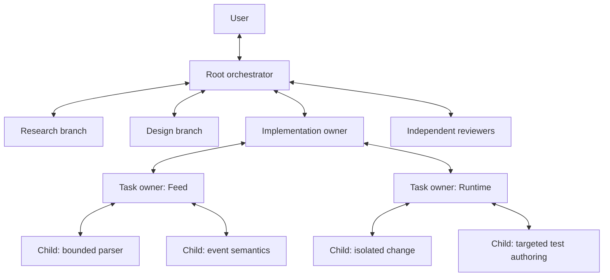
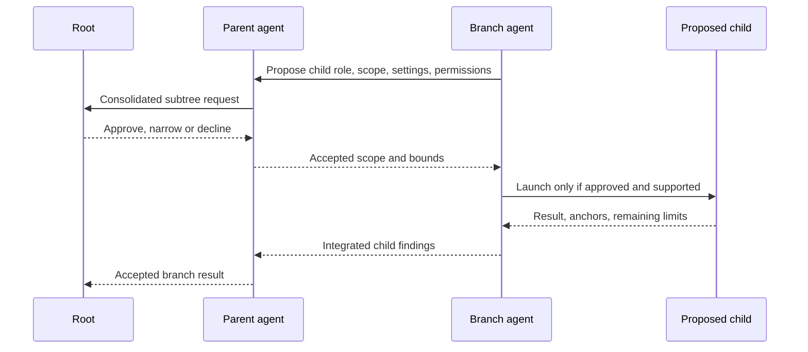
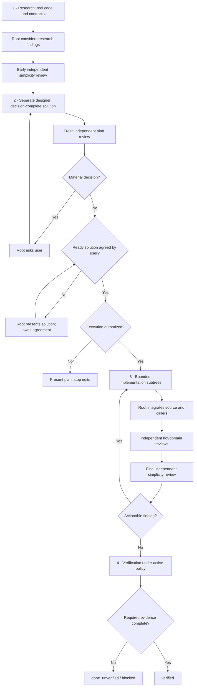
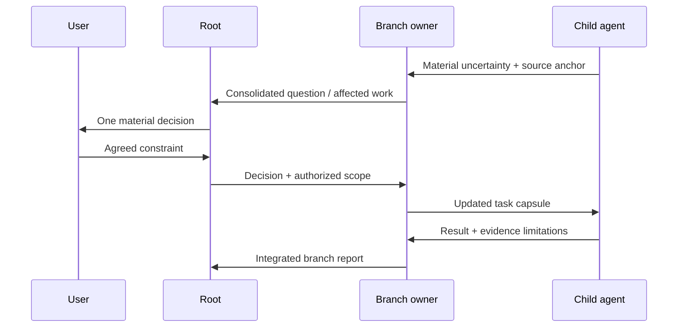

# Agent cascade, recursive delegation and independent review

This is the portable agent-orchestration contract. It applies through the
agent platform's actual capabilities; it does not require a particular model,
agent filename, multi-agent API, token tier or orchestration service.
Explicit project rules replace corresponding workflow rules here; apply the
skill where they leave gaps, without calling overridden stages incomplete.

## Contents

- [Ownership and recursive tree](#ownership-of-the-whole-result)
- [Four-stage cascade and questions](#four-stage-cascade-with-feedback)
- [Roles, task capsules and owned scopes](#role-and-effort-selection)
- [Fresh independent plan review](#fresh-independent-plan-review)
- [Final independent code review](#review-independence-and-the-simplicity-specialist)

## Ownership of the whole result

- The **root orchestrator** receives the user's task, clarifies material
  choices, preserves the agreed outcome and authorization, integrates all
  branches, resolves contradictions, and owns final user communication.
- Research, design, implementation and review are different responsibilities.
  They may use the same available agent platform but must not treat their
  outputs as mutually substitutable evidence.
- A parent owns its accepted subtree and consolidates its child results before
  returning to its parent. The root retains the final integration responsibility.
- **Root approval is required for each proposed nested subtree**, not just for
  initial top-level branches. The prospective parent forwards the proposed
  role(s), actual supported model/effort where relevant, owned scope,
  dependencies, action permissions and reason to the root. The root approves,
  reduces or declines it within existing task authority before children are
  launched. This is an internal coordination gate, not a new user approval
  for every worker or an expansion of the user's permissions.
- Use recursion only for genuinely independent, well-bounded results that
  benefit from it. A small or tightly coupled task stays with one agent.
  Concurrency and depth are bounded by the actual runtime, not by an arbitrary
  target number of workers.
- A nested agent may **propose** child roles, scopes, supported settings and
  required evidence to its parent; that parent consolidates the proposal to
  root, awaits approval, then owns the accepted branch and integrates its
  children's evidence. No child invents permission to edit, run, trade or
  contact the user directly.

## Recursive ownership tree

The double arrows denote task/plan delivery and feedback. Branches are
optional, never a mandatory agent quota. Child-to-parent reports are
consolidated upward; user questions go through the root, not direct child-user
side channels. Reviewers are independent of the author of the reviewed change.

## Nested subtree approval and feedback

A branch may recurse again through the same approval chain. The root retains
shared files, inter-branch reconciliation, all user decisions, and final
integration. Subtree approval does not expand the active authority for tests,
benchmarks, source edits, network actions or live trading.

## Four-stage cascade with feedback

This depicts responsibilities and authorization boundaries, not automatic
execution. Verification follows the authority rules in
[workflow-and-plans.md](workflow-and-plans.md); an independent code review is
not a test or performance benchmark. Small direct tasks bypass the full cascade;
high-risk plans still receive fresh independent plan review, without requiring
a separate designer merely for risk. Simplicity stages apply to substantive
code tasks; report unavailable applicable stages without simulating clearance.

## Questions and handoffs

The root deduplicates questions, resolves routine details from sources and
continues independent work while a dependent decision is outstanding. An
incidental status message does not revoke existing task authorization; an
explicit pause, cancellation or scope change does.

## Research, design and implementation sequencing

1. **Research:** inspect actual owners, relevant declarations, registrations,
   callers, production surfaces and failure paths. Give exact source anchors,
   not guesses. Return findings to root, which considers them before starting
   design. Research is read-only and does not pre-authorize implementation.
2. **Design:** root starts a separate designer with the relevant research
   findings, settled decisions and constraints. In a full cascade, a second
   reasoning pass by the researcher or root does not replace this agent.
   Settle observable behavior, normal/failure scenarios, ownership, interfaces,
   dependency closure, acceptance and evidence. Send material questions through
   root. A complex full-cascade or high-risk plan receives a fresh independent
   read-only review before the root asks the user to agree the ready design.
   The user agrees the integrated ready solution before first implementation
   in a non-trivial full cascade. An already agreed unchanged plan and active
   execution permission require no renewed approval.
3. **Implementation:** only after applicable agreement/permission, delegate
   atomic tasks with non-overlapping owners and near-patch specifications.
   The root owns shared registries/manifests/public integration files. A worker
   proposes bounded child roles/scopes/settings through its parent to root and
   may launch only after root approves and the runtime permits it; the parent
   returns consolidated results upstream.
4. **Integration/review/verification:** root inspects actual changed code and
   consumers, then obtains relevant independent reviews. Resolve veto findings
   within authority; re-review only changed/repaired critical surfaces. Tests,
   benchmarks, runtime and live checks retain their distinct evidence and
   authorization under the active user/project/runtime policy.

If an applicable separate designer or independent reviewer cannot be provided,
report which stage is unavailable. Continue independent authorized work without
claiming that self-review satisfies the missing independent stage; material
unresolved decisions still stop dependent implementation.

## Role and effort selection

- Select capability from the task, not a fixed model leaderboard: bounded
  researcher/explorer; architect/designer for uncertain contracts; mechanical
  worker for fully specified edits; domain engineer for substantive changes;
  independent specialist reviewer for critical risk.
- Give a mechanical worker only settled, small tasks and sufficient patch shape;
  return design gaps to the parent instead of improvising new behavior.
- Increase reasoning depth for cross-boundary architecture, high-risk decisions,
  final critical review, or independent contradiction resolution. Broad
  escalation is occasional and must have a concrete purpose.
- Model names, numeric reasoning levels, and service tiers are environment
  choices. Prompt text does not switch the runtime's actual model or mode.
  Confirm only capabilities and selected settings that the platform exposes.
- Do not spawn all applicable roles by default. A single agent can apply
  several review lenses; distinct threads are justified by independent scope,
  useful parallelism or an independent-review requirement.
- Keep computation/memory latency, network latency and transport correctness
  as distinct capabilities. Computation/memory covers bounded work, allocation,
  locality, contention and scheduling; network latency covers RX/TX through
  protocol, socket, kernel and NIC costs. Transport correctness covers trust,
  framing, partial I/O, deadlines and session/recovery invariants. Endpoint and
  location evidence belongs to placement expertise, not kernel tuning. See
  [transport-and-readiness.md](transport-and-readiness.md) for network scope and
  shared system-context evidence.

## Task capsule and safe ownership

Provide a child a compact, self-contained assignment:

- Observable outcome; exact owned paths, symbols and structures.
- Relevant contracts, source anchors, settled decisions and available evidence.
- Branch behavior, affected callers/consumers/registrations, and shared owners.
- Test scenarios, acceptance criteria and explicit anti-criteria.
- Exact authorized actions/checks, if any; otherwise state **none**.
- Expected output and evidence limitations.

Workers do not edit outside their owned scope, revert others' changes, write
shared integration files, perform drive-by formatting, silently expand
requirements or mark their own work verified. A worker's report is a claim;
root reopens key source and integration edges. Resolve conflicting reports by
examining disputed anchors, not by counting agents.

Fresh-context workers should receive only the capsule and necessary rules.
Do not flood them with full chat history, unrelated files, old reviewer opinions
or suggested answers to the very question they must independently evaluate.
After context loss, pass compact agreed decisions and unfinished evidence;
reuse prior validated findings instead of restarting discovery.

## Fresh independent plan review

- For a high-risk plan or non-trivial full cascade, obtain one new read-only
  reviewer **independent of the writer, researcher and designer** before
  presenting the ready design for user agreement, when available. A follow-up
  conversation with an existing reviewer is not a new fresh review.
- Supply the **complete exact plan snapshot**, not a summary: all settled
  behavior, sequencing, ownership, affected interfaces, dependencies, normal
  and unknown/failure outcomes, permissions, acceptance and anti-criteria.
  Include applicable project rules and bounded source anchors; for an existing
  plan file, include its path and exact text/revision. An in-chat plan needs no
  artificial file merely to be reviewed.
- Exclude prior chat history, the author's rationale outside the plan,
  preceding reviewer findings, personal memories and leading answers. Fresh
  *conversation context* is not filesystem isolation or permission to ignore
  applicable repository rules.
- First have the reviewer **independently paraphrase** the intended result,
  invariants, change sequence and acceptance without filling missing details.
  Then inspect relevant anchored source and test hidden assumptions, actual
  callers, ownership conflicts, dependencies and failure behavior. Return
  `CLEAR` for a bounded inspected scope or actionable findings with severity,
  exact plan section/source anchor, violated condition and evidence limits.
- Root compares the paraphrase to user intent, checks disputed claims at the
  source and integrates findings. If the plan changed since the snapshot,
  the verdict applies **only to the reviewed revision**. A material change to
  behavior, ownership, interfaces, dependencies, permissions, failure policy
  or acceptance calls for another fresh review; editorial fixes do not.
- If a fresh independent reviewer, full snapshot or needed source is
  unavailable, state precisely that review was not completed. Never simulate
  independence, infer clearance from the writer's self-check, or treat plan
  review as final code-review or test proof.

## Review independence and the simplicity specialist

- For substantive code tasks, require an independent simplicity reviewer
  **early**, once scope is known and before choosing the implementation, and
  **late**, after integration and the relevant specialist reviews, when agents
  are available. Early review searches for reuse and unnecessary layers; final
  review inspects the actual integrated change. Both are read-only unless
  given a separate authorized implementation task. Findings go through the
  change owner and root; they do not automatically expand the assignment.
  Tiny mechanical tasks need neither a full cascade nor these consultations.
  If participation is unavailable, report the missing consultation and
  continue independent authorized work. Simplicity never replaces domain or
  latency review; material repairs to a critical surface repeat its affected
  specialist reviews before the final simplicity review.
- Select required critical reviewers from the matrix below. For the required
  network H0/H1 trio, network latency and transport correctness are independent
  roles; one cannot satisfy both.
- Critical reviewers must be independent of the author and inspect the final
  relevant source; report CLEAR or findings with severity, exact path/symbol,
  violated invariant, observed evidence and limits. A reviewer cannot grant
  build/test/live authority or claim passing tests from code inspection.
- Perform critical reviews against the **root-integrated** source after
  implementation, not a worker's proposed diff in isolation. Each required
  reviewer uses a distinct independent read-only thread when supported;
  neither reviewer nor simplicity review stands in for another required role
  or verification governed by the active policy.
- Documentation, test-only or strictly mechanical edits do not automatically
  trigger runtime reviews merely by naming a hot or network subsystem. An unchanged
  CLEAR surface needs no repeated review. Repeat only after a concrete repair
  or material change, and restrict to that affected surface.
- If a required independent reviewer or fresh context is unavailable, report
  that the gate did not run; do not simulate clearance. Independent findings
  are vetoes only when tied to a concrete violated or undefined contract.

## Critical review matrix

Apply by actual changed behavior, including configuration that changes that
behavior. The network H0/H1 row takes precedence over the ordinary H0/H1 pair.

| Changed surface | Minimum independent final reviewers |
| --- | --- |
| Actual non-network H0/H1 | Computation/memory latency + relevant parser, runtime, execution or other domain specialist |
| Actual network change affecting H0/H1 | Computation/memory latency + network latency + transport correctness: **three distinct threads** |
| Pure C/D network change with no hot-path effect | Expertise selected by concrete risk; no fixed reviewer quota |
| Substantive offline financial computation under an explicitly required strict compute contract | Computation/memory latency + quant/financial semantics |

Before using the pure C/D row, bound the inspection to affected callers,
shared code, configuration and contracts to establish that hot RX/TX behavior,
parameters consumed by H0/H1 and H0/H1 semantics are unaffected. Trading depending
on connection readiness alone is not a hot-path effect. Changes affecting those
hot operations or contracts require the trio even if edited in setup code. If uncertain, do not claim
the cold exemption: investigate and route material uncertainty through root
under the existing decision rules.

Add independent parser, runtime/execution or quant review when a network change
also changes substantial separate semantic invariants; the network trio does
not cover those by implication. Simplicity review never counts toward these
minimums. Classification as C does not impose blanket strict-H0 restrictions;
the selected project/profile still controls those restrictions. Report missing
agents or unsupported independent threads without simulating clearance.

## Root integration and terminal handoff

- The root merges duplicate findings, resolves contradictory claims against
  source, closes changed registrations and consumers, preserves unrelated work
  and carries agreed decisions into the final result.
- The parent returns outcomes, changed/inspected paths, exact checks actually
  run, limitations, blockers, dependent scopes, and any unresolved user choice.
- `done_unverified` is an integrated implementation, not passed tests.
  `verified` requires the selected evidence; the reviewer and worker cannot
  promote their own output just by asserting readiness.
