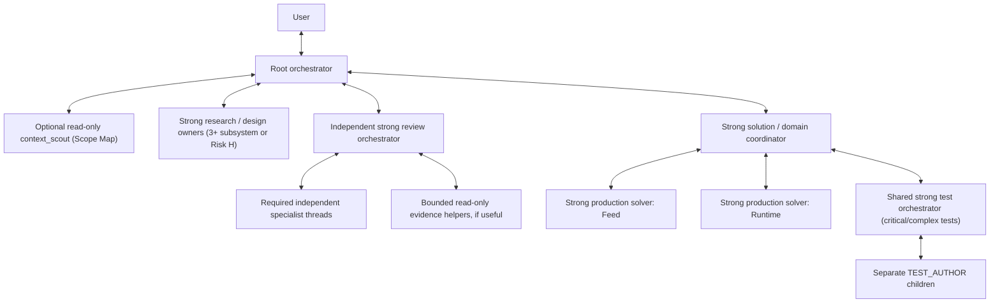
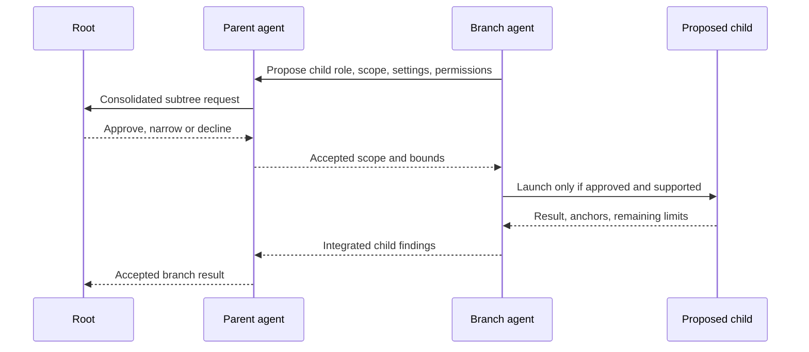
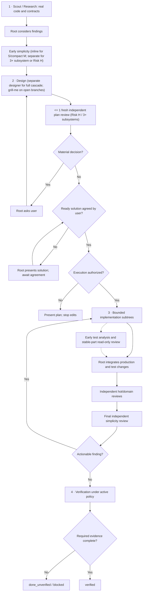
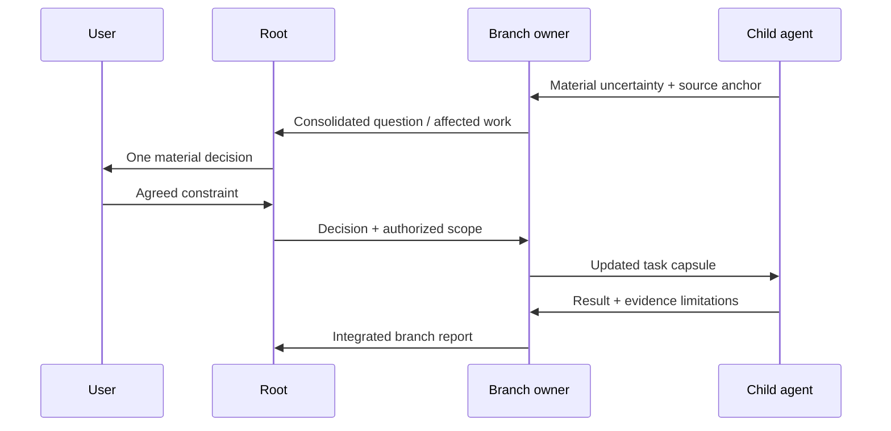

# Agent cascade, recursive delegation and independent review

This is the portable agent-orchestration contract. It applies through the
agent platform's actual capabilities; it does not require a particular model,
agent filename, multi-agent API, token tier or orchestration service.
Explicit project rules replace corresponding workflow rules here; apply the
skill where they leave gaps, without calling overridden stages incomplete.

## Contents

- [Ownership and recursive tree](#ownership-of-the-whole-result)
- [Native coordination and strong branch owners](#native-coordination-and-strong-branch-owners)
- [Four-stage cascade and questions](#four-stage-cascade-with-feedback)
- [Roles, context scout and task capsules](#role-and-effort-selection)
- [Test orchestration and authorship](#test-orchestration-and-authorship)
- [Fresh independent plan review](#fresh-independent-plan-review)
- [Final independent code review](#review-independence-and-the-simplicity-specialist)

## Ownership of the whole result

- The **root orchestrator** receives the user's task, clarifies material
  choices, preserves agreed outcomes and permissions, integrates all branches,
  resolves contradictions, and owns final user communication.
- Research, design, implementation and review are distinct responsibilities;
  their outputs are never mutually substitutable evidence.
- Each parent owns its accepted subtree and consolidates child results upward.
  **Root approval is required for each proposed nested subtree** (proposed role,
  supported model/effort where exposed, owned scope, dependencies, permissions
  and reason) before children launch. This is an internal coordination gate, not
  a new user approval or permission expansion.
- Use recursion only for genuinely independent, well-bounded results. Concurrency
  and depth follow the actual runtime, never an arbitrary worker target. No
  child invents permission to edit, run checks, trade or contact the user directly.

## Recursive ownership tree

Branches are optional, never a mandatory quota. Child-to-parent reports
consolidate upward; all user questions route through root. Reviewers remain
independent of the authors they review.

## Native coordination and strong branch owners

For large work, place coherent research, design, solution, test and review
branches under strong owners without inserting empty levels. A solution/domain
owner owns interfaces, dependencies and integration of its scope; substantive
production authors are strong agents. Mechanical helpers collect bounded
read-only evidence or apply strictly deterministic, settled edits outside
critical logic (and ready-spec non-critical tests below) where host policy
permits; they never improvise behavior or review verdicts.

An independent strong review orchestrator (separate from solution, test
orchestrator and authors) owns risk coverage and consolidated findings without
writing the reviewed code, replacing required specialist threads, overriding
concrete vetoes, or self-clearing gates.

All participants run inside the host's **native agent or swarm runtime** using
only actually exposed worker, coordinator, board/event and messaging channels —
never add a second scheduler, dispatcher, queue, daemon, private API or vendor
patch. If native nested helpers are unavailable, root dispatches the approved
leaf tasks directly and reports the flattened runtime honestly. A shared board
does not establish review independence; fresh reviewers still receive fresh
context excluding peer opinions and prior verdicts.

## Nested subtree approval and feedback

## Four-stage cascade with feedback

**Scope scaling:** **Risk S** and compact **1–2 module/crate Risk M** tasks stay
direct-first in root (inline discovery, planning and early simplicity; no full
cascade). **3+ subsystem** or **Risk H** cascades use separate research -> root
-> separate designer -> at most one fresh plan review pass. Test analysis and
read-only review of stable parts may overlap remaining implementation, while
final review always inspects the integrated snapshot.

## Questions and handoffs

Root deduplicates user questions, resolves routine facts from source, and
continues independent work while a dependent decision waits. An incidental
question never revokes active task authorization; an explicit pause,
cancellation or scope change does.

## Role and effort selection

- Select capability from task risk, not a fixed model leaderboard: strong
  owners/authors for substantive design, production code and critical reviews;
  strong semantic test owners for critical tests; mechanical helpers only for
  settled, bounded specifications (returning any design gap to parent).
- **Read-only `context_scout` (2–4 turns):** on unfamiliar multi-file first
  launches or before heavy specialist reviews, optionally dispatch a fast,
  read-only scout to locate the exact target surface via indexed search /
  symbol inspection and return a compact **Scope Map** (exact files, line
  ranges, symbol spans, callers/registrations) with **zero architectural or
  review conclusions**. Skip for 1–2 already-known files.
- **Full actionable task spec for strong workers:** never launch a strong
  solver or reviewer with a vague prompt. Supply the concrete observable
  outcome, disjoint owned scope, Scope Map/source anchors, hard invariants,
  settled decisions, acceptance & anti-criteria, and exact authorized checks
  (or **none**).
- Keep computation/memory latency, network latency and transport correctness
  distinct (see [transport-and-readiness.md](transport-and-readiness.md));
  confirm only runtime model/effort settings that the host actually exposes
  (prompt text never switches a running thread).
- **Boost conflict escalation:** when a non-trivial disagreement arises (with
  the user, between workers, or between reviewers), focus deep resolution
  strictly on that contested node: competing hypotheses, direct source/codegen/
  measurement evidence, an optional independent strong challenger, and an
  explicit trade-off verdict.

## Test orchestration and authorship

Scale test ownership to actual risk and only when tests are inside task scope
([workflow-and-plans.md](workflow-and-plans.md#keep-verification-within-the-task)
owns test necessity and run authority):

- **Localized mechanical repairs and obvious local regressions:** the fix author
  or primary integrator may perform localized mechanical test/fixture repairs
  (e.g., migrating a signature or catalog capacity while preserving scenario,
  independently justified expectations and assertions) and may write an ordinary
  regression test whose expected outcome is unambiguous, without spawning an
  empty test subtree. Changes altering financial, recovery, order-state or
  authority semantics are never mechanical.
- **Critical or non-obvious test scenarios:** financial, recovery, order-state,
  authority, and any test whose expected result requires independent
  justification **must** be authored outside production authorship and final
  reviewers through a strong **TEST_ORCHESTRATOR** (read-only scenario design,
  fixture realism, independent expected results, clock/unit/lifetime checks and
  failure triage — never editing tests itself) dispatching separate
  **TEST_AUTHOR** children (strong author for critical/complex tests; mechanical
  author only for a complete ready non-critical specification).
- **Ownership and updates:** assign disjoint production and test files in a
  shared branch, keep shared registrations/manifests with one integration owner,
  and relay current-task decisions/snapshots at binding, contract changes,
  failures, review repairs and final freeze (never as a global background
  watcher). Run selected tests only on an identified stable snapshot.
- **Failures and integrity:** classify defects (production vs test/fixture vs
  infrastructure) and route to their owner. Compiler or environment failure is
  `BLOCKED`, not behavioral `RED`. Never weaken assertions or soften expected
  values merely to obtain `GREEN`; revise an expectation only when its semantic
  justification was wrong and record why.

## Task capsule and anti-stall delivery

### Self-contained capsule

Every worker capsule includes:
- Observable outcome, disjoint owned paths/symbols, and Scope Map / anchors.
- Hard invariants, settled decisions, affected callers/consumers, shared owners,
  and (on touched H0/H1 or strict compute cores) the relevant
  [computation-ahead contract](hot-cold-paths.md#computation-ahead-of-the-event-and-specialization).
- Test ownership boundary, acceptance & anti-criteria, exact authorized checks
  (or **none**), and required output/evidence limits.

Workers never edit outside owned scope, revert foreign changes, write shared
integration files, perform drive-by formatting, or mark their own work
`verified`. Fresh reviewers receive only the capsule and necessary rules — never
chat history, peer opinions, or leading answers.

### Anti-Stall & Delivery Contract (portable)

- **Explicit return channel and bounded terminal reasoning:** include the exact
  parent return address or board recipient in every capsule and require explicit
  terminal delivery on the host's native reply/board channel. Keep final-turn
  reasoning brief (`<= 3` sentences) right before delivering results so output
  limits never truncate delivery.
- **Whole-file / symbol retrieval and sharded sweeps:** resolve target paths
  before reading; prefer indexed search, compact symbol bodies, or single-call
  whole-file reads (within the host tool's inline limit) over repeated chunked
  slicing loops (`100–400` line shell slices) or re-reading unchanged files.
  Shard broad multi-file sweeps to roughly `~5–8` files/venues per worker with
  disjoint ownership.
- **2-tick wait recovery for multi-worker waves:** when the host provides wait
  timers/watchdogs and a coordinator waits on a multi-worker wave, arm a
  one-shot watchdog (`~180s` first tick). On **Tick 1**, inspect progress and
  nudge silent stragglers (do **not** blindly kill and restart full scopes) and
  arm **Tick 2 (`+120s`)** for narrow salvage or replacement of only the stalled
  slice. Single short-lived read-only scouts need no heavy watchdog ceremony.
- **No child polling loops or shared-build contention:** forbid child workers
  from running polling timer loops against sibling sessions, and serialize
  builds/tests against any shared build tree (e.g., shared `build/` or Cargo
  `target/`) in the primary integrator unless isolated trees are authorized.

## Fresh independent plan review

- For **Risk H** or **3+ subsystem** full-cascade plans, run **at most one**
  fresh-context read-only review pass independent of the writer, researcher and
  designer before user agreement (Risk S and compact 1–2 module Risk M plans
  skip this pass). A follow-up in an existing thread is not a fresh review.
- Supply the **complete exact plan snapshot**, applicable rules and bounded
  source anchors — excluding chat history, writer rationale, prior reviews and
  leading answers.
- Have the reviewer first **paraphrase** intended outcome, invariants, sequence
  and acceptance without guessing gaps, then check anchored sources for hidden
  assumptions, caller/ownership conflicts and failure behavior, returning `CLEAR`
  or severity-tagged findings with anchors and evidence limits.
- Root compares the paraphrase to user intent and integrates routine findings
  directly **without `v2`/`v3`/`v4` re-review loops** (truthfully noting
  post-snapshot edits; renew fresh review only if a user decision fundamentally
  replaces core architecture, ownership or safety). Report unavailable review
  honestly without simulating independence.

## Review independence and the simplicity specialist

- **Scope-scaled simplicity:** apply
  [minimum-checks](architecture-and-contracts.md#minimum-necessary-checks-and-repeated-work)
  and single-owner simplicity across code, added tests, fixtures and scripts:
  inline in root for **Risk S** and compact **1–2 module Risk M**; separate
  read-only **early** simplicity reviewer for **3+ subsystem / Risk H** cascades;
  separate **final** simplicity reviewer **late** on substantive integrated
  diffs after relevant specialist reviews (skipping tiny mechanical edits).
  Simplicity never replaces required domain/latency specialists; material
  critical repairs re-run affected specialist reviews before final simplicity.
- **Integrated independent critical reviews:** run required reviewers from the
  matrix below against the **root-integrated** diff as distinct read-only
  threads independent of production and test authors. Documentation, test-only
  or behavior-preserving mechanical edits do not trigger runtime gates by name
  alone. Reuse `CLEAR` verdicts on unchanged surfaces; re-review only repaired
  affected surfaces. Missing unrequested checks are evidence limits, not vetoes;
  report unavailable reviewers without simulating clearance.

## Critical review matrix

Apply by actual changed behavior (including configuration affecting that
behavior). The network H0/H1 row takes precedence over the non-network H0/H1 pair.

| Changed surface | Minimum independent final reviewers |
| --- | --- |
| Actual non-network H0/H1 | Computation/memory latency + relevant parser, runtime, execution or other domain specialist |
| Actual network change affecting H0/H1 | Computation/memory latency + network latency + transport correctness: **three distinct threads** |
| Pure C/D network change with no hot-path effect | Expertise selected by concrete risk; no fixed reviewer quota |
| Substantive offline financial computation under an explicitly required strict compute contract | Computation/memory latency + quant/financial semantics |

Before using the pure C/D row, trace affected callers, shared code and
configuration to prove hot RX/TX behavior and H0/H1 parameters/semantics are
unaffected (ordinary dependence on connection readiness is not a hot-path
effect; setup code changing hot parameters still requires the trio). Add parser,
runtime/execution or quant reviewers when a network change also alters those
invariants; simplicity review never counts toward these minimums.

## Root integration and terminal handoff

- Root merges duplicate findings, resolves contradictions at the source, closes
  registrations and consumers, preserves unrelated work, and carries agreed
  decisions into the final report.
- `done_unverified` is an integrated implementation without executed
  verification; `verified` requires recorded passing evidence under active
  policy. Neither workers nor reviewers can self-promote work to `verified`.
