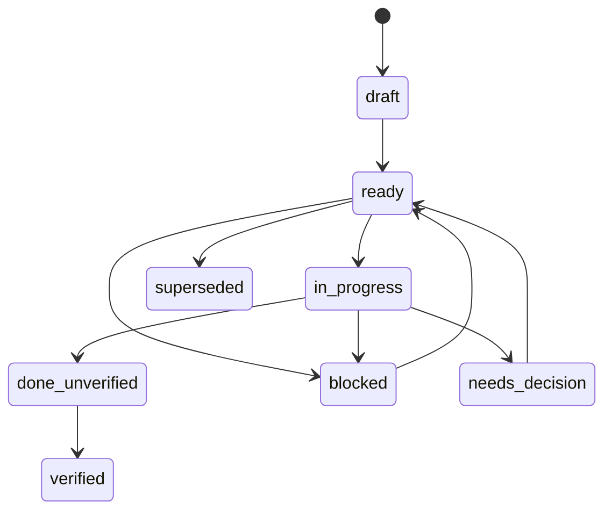

# Development workflow, permissions, checks and durable plans

## Contents

- [Risk and agreement](#match-ceremony-to-actual-risk)
- [Proportionate verification](#keep-verification-within-the-task)
- [Authority and exact checks](#authority-boundaries)
- [Evidence](#checks-and-evidence-handling)
- [Durable plan tasks and states](#durable-task-plans-when-actually-needed)

## Match ceremony to actual risk

- **S (small):** direct bounded source inspection, authorized edit if requested,
  compact report. No plan files or agent cascade by default.
- **M (moderate):** in-chat plan and targeted owner/caller closure.
- **H (high):** settle behavior and failure policy before dependent changes,
  use independent fresh-context plan review when available and agreement for
  non-trivial full-cascade work. A small diff can still be high-risk if it
  affects hot path, serialized contracts, recovery, safety or live orders.
- For a fresh plan review, send the independent reviewer the **complete exact
  current plan snapshot**, applicable rules and bounded source anchors, without
  writer rationale, conversation history or previous reviews. Require an
  independent paraphrase and source-grounded findings. Compare the inspected
  revision before user agreement; material changes require renewed review.
  See [delegation-and-review.md](delegation-and-review.md).
- Keep an ordinary plan in chat. Persist a plan only when explicitly requested
  or cross-session continuation actually needs it. A plan is a specification,
  not permission or verified evidence.

## Agreement before behavior changes

1. State the minimum requested observable outcome and actual existing behavior.
   Find its canonical owner, necessary prerequisites and current callers.
2. For non-trivial behavior, describe an event cycle with a normal path and
   relevant failure/partial path. Settle public interfaces, numeric meaning,
   readiness/refusal/recovery semantics and acceptance criteria.
3. Ask only material unresolved questions that change behavior, ownership,
   security, financial state or recovery. Resolve routine implementation
   details from code. Carry settled choices through refactor and optimization.
4. Implement the smallest complete authorized change. Read declarations,
   callers and analogues first; preserve unrelated edits and registered tests.
   Prefer sufficient existing tests; add a focused regression only for a concrete
   defect or substantial behavioral risk not adequately covered by them. Small
   reversible edits do not by themselves require new tests. Test observable
   outcomes or meaningful failure cases rather than merely restating implementation
   details; avoid tests for prose, per-method quotas or APIs solely for test convenience.
5. Inspect integration and report implementation separately from tests that
   did or did not run. Do not recreate a failing test history by destroying an
   already suitable implementation; TDD is optional unless requested.

## Keep verification within the task

Assess the whole path: build dependencies, fixtures, data preparation, environment
and maintenance cost. A narrowly named target need not be a small check. Before
materially extending verification, identify the uncovered risk of the original
task and why existing means are insufficient. Prefer an existing sufficient check
over new infrastructure; explain material tradeoffs in the normal discussion,
without a new checklist or artifact. Permission to run a command does not itself
justify expanding the verification package.

Classify a failure as a task defect, a necessary dependency or an unrelated
check/environment problem. Fix affected code and small defects in its test setup
within the agreed scope. Failure does not automatically add tasks or acceptance
criteria. Route foreign-suite repairs, substantial harness expansion or a new
environment through root; material scope or authority changes go to the user
before dependent work. A necessary dependency may justify that decision, but
repairing the check is not a goal in itself. Continue independent authorized work
and report the blocked check separately.

Preserve existing coverage, assertions and selected acceptance gates. Missing
unrequested tests are evidence limits, not new defects or review vetoes. Stop
once the agreed result and selected acceptance are met; do not add runs merely
to obtain stronger evidence labels. Necessary repeats follow the active policy
below, without an arbitrary attempt limit or an additional approval ritual.

## Authority boundaries

The active user's instructions, project rules and runtime restrictions govern
authorization. This section is the bundle's common authority reference; it
does not impose a separate approval ritual for ordinary tests or builds.
Explicit project rules replace corresponding skill workflow rules; the skill
fills gaps. An overridden stage is not an incomplete required stage.

- **Study/diagnose/review/status:** read-only. No source or plan-state edits.
- **Plan:** write selected plan artifacts only when permitted by the user and
  active mode. Planning does not itself authorize implementation or runs.
- **Implement:** perform the requested edits and useful test additions. Run
  ordinary targeted tests/builds when covered by the task and active policy;
  if that policy requires separate command approval, obtain it before running.
- **Verify:** choose the smallest relevant checks and identify commands,
  working directory, purpose, targets/profile, resources and side effects.
  Ask when required by active policy or when a material permission is unclear;
  do not ask again for checks already authorized. A plan or worker naming a
  command does not itself grant permission.
- **Higher-impact:** full builds, sanitizers, benchmarks, baselines, runtime,
  external network/model/browser actions, services, Git writes, destructive
  commands and live account/order actions need the distinct approval required
  by the active user/project policy. Never bypass security or environment
  blockers, bootstrap tools or alter target profiles to get a green check.
- Authorization persists within its agreed task and scope until completion,
  cancellation or scope change; an explicit pause suspends it. Repeat only
  after a concrete affected fix/change or a resolved blocker within the agreed
  scope or an authorized extension, with reason and prior result inspected.
  Reassess changed commands, profiles or resources against that scope and seek
  new approval where required. Failure alone is not a retry instruction.
- A skill, hook, agent, sandbox capability, plan, status or reviewer does not
  grant actions beyond the user's or runtime's actual authority.

## Checks and evidence handling

- Classify commands by effects, not names: a Python wrapper can still compile
  the production binary; a seemingly local tool can still contact an exchange.
- Keep owner-specific build trees, target/toolchain identity and resource
  containment consistent. A missing dependency, busy lock or incompatible
  cache is `BLOCKED`, not permission to repair it with an unapproved rebuild.
- Run only checks covered by the active authorization. Here, a selected check
  means one chosen within that authority, not necessarily a separate user
  approval exchange. Preserve exact command, working directory, profile,
  final integer exit status and full logs for each
  selected attempt. Compact the displayed summary, not the underlying evidence.
- Truncated/error-filtered output, progress percentages, worker claims, old
  executables and a disappearing process do not prove success. On interruption,
  inspect process ownership, output and last completed phase before considering
  another attempt. Never kill another owner's process to clear a conflict.
- A successful check stops until the affected code changes. An unsuccessful
  attempt remains visible in the history; do not silently erase it.
- Each **required evidence type is independent**. For promotion to `verified`,
  every required command for the current task and revision must
  have a recorded **latest completed integer exit status of `0`**. A previous
  pass does not override a later failed attempt; preserve the earlier pass and
  later failure in history. A boolean, absent status, truncated progress line,
  skipped command or stale result is not a passing exit code.
- Analyze the actual source changes and any already available completed CI
  results. Do not wait for unrelated CI jobs to finish before reporting
  source-level findings; do not claim pending/skipped CI is a passed check.
- Distinguish static, schema, build, targeted-test, runtime, browser, model,
  performance and live evidence. None implies another. A review alone is not
  execution evidence; missing unrequested checks are limitations, not fabricated
  failures or blockers to an implementation-only completion.

## Durable task plans when actually needed

One plan should contain a decision-complete human specification and, if a
project already supports it, a machine-readable state tied to the exact plan
revision. Do not introduce a state manager, receipt service, hooks or a Goal
as mandatory dependencies of an ordinary task.

Include for each task:

- Stable task ID, title and `MECHANICAL` / `LOGIC` / `COMPLEX` classification.
- Goal, compact task capsule, declared owner and non-overlapping owned paths.
- Dependencies, symbols/callbacks/targets and shared files kept with primary.
- Acceptance and explicit anti-criteria, failure/unknown policy and permissions.
- Required evidence types and exact selected commands, or an explicit
  implementation-only/static boundary.

Classify `MECHANICAL` only when no design decision remains and the patch shape
is specified. `LOGIC` has settled behavior with normal judgment; `COMPLEX`
involves cross-boundary/high-risk reasoning or design. A worker may not
silently upgrade the task scope.

Only run ready tasks whose dependencies are centrally integrated as
`done_unverified` or `verified`. The primary inspects worker output before
recording `done_unverified`; verification promotes to `verified` only when
every required independent evidence type is present and each declared current
selected command has latest integer exit status `0`. A later failing run
invalidates the previous passing verdict until the relevant gate is satisfied
again; it does not delete earlier attempts. An implementation-only task may
validly finish `done_unverified` without claiming unrequested tests.
Missing permissions, stale state, ambiguous plan selection, dependency cycles,
conflicting owners or plan revision drift stop the affected transition.
Continue independent already-authorized tasks when one branch is blocked.

If state files are used, use a single current structure, declared transition
rules, guarded atomic writes and a nonblocking owner lock where available.
Bind state to plan content when the project supports a hash, retain failed
attempts, and refuse malformed/incompatible input without inventing evidence.
Only archive a truly clean verified plan when separately authorized. A new
plan does not prove an older one completed.

Native Goal/task features, personal task cards and agent handoff records may
help continuity where available, but neither replaces the selected plan nor
confers permission. Planning alone does not launch execution; unavailability
of those features must not be simulated with fabricated states.
